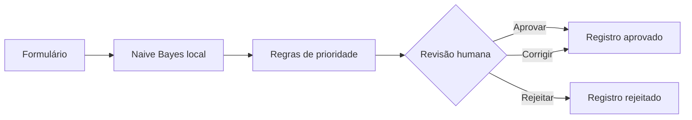

# FlowPilot AI — Intelligent Workflow Studio

Projeto independente de portfólio de **Douglas Paiva**, com interface funcional para triagem de solicitações, classificação por aprendizado de máquina, regras de roteamento e validação humana.

**[Abrir demonstração interativa](https://flowpilot-ai-douglas-paiva.dougllas-paiva.chatgpt.site)** · [Perfil profissional de Douglas](https://www.linkedin.com/in/dougllaspaiva/)

> **Ambiente demonstrativo.** Os registros iniciais e os textos de treinamento são sintéticos. Não representa produto, cliente, processo interno ou resultado de qualquer empresa.

## O problema

Muitas equipes recebem solicitações em canais dispersos e precisam decidir manualmente a quem encaminhá-las. Uma primeira classificação automatizada, acompanhada de regras explícitas e revisão humana, pode apoiar esse processo. A economia de tempo é uma **hipótese a testar**, não um resultado comprovado nesta demonstração.

### Solução demonstrada

1. A pessoa descreve uma solicitação em linguagem natural.
2. Um classificador estatístico sugere a área responsável.
3. Um conjunto separado de regras indica a prioridade.
4. Uma pessoa confere, aprova, corrige ou rejeita a sugestão.
5. Os registros ficam disponíveis para consulta, filtros, indicadores e exportação CSV **somente no navegador em uso**.

O objetivo desta versão é comprovar o **funcionamento do protótipo**, não uma redução mensurada de custos ou de SLA.

## O que funciona

- Formulário para título, contexto, origem e urgência;
- Classificador **Naive Bayes multinomial local**, treinado com 40 exemplos sintéticos em português;
- Score relativo entre cinco categorias (Tecnologia, Financeiro, Pessoas & Cultura, Operações e Comercial);
- Regra determinística de prioridade independente do classificador;
- Revisão humana para aprovar, rejeitar ou corrigir a **sugestão** de destino;
- Fila com filtros, pesquisa e detalhes auditáveis;
- Indicadores e exportação CSV;
- Persistência apenas no `localStorage` do próprio navegador;
- Interface responsiva, sem dependências ou backend.

## O que **não** existe nesta versão

- Não há integração com LLM, API externa ou serviço de IA generativa.
- Não há processamento de dados corporativos reais, autenticação, roteamento externo ou disparo de e-mails.
- Aprovar um destino **não envia** o chamado a nenhuma empresa, e-mail ou profissional.
- O score é relativo entre as classes, **não é uma probabilidade calibrada de acerto**.
- Registros iniciais, percentuais exibidos e decisões da amostra são ilustrativos; não demonstram ganho operacional real.

## Como experimentar

1. Abra `dist/index.html` em um navegador moderno.
2. No Laboratório, selecione um dos três cenários fictícios ou descreva uma solicitação própria sem dados sensíveis.
3. Clique em **Analisar solicitação**.
4. Examine a sugestão do classificador e sua justificativa, corrija o destino se necessário e aprove ou rejeite a simulação.
5. Confira a Fila operacional, filtros, indicadores e JSON estruturado.
6. Exporte o CSV ou restaure os dados sintéticos para repetir o teste.

## Arquitetura

## Evoluções previstas, ainda não implementadas

1. Integração segura com modelo generativo por API no backend, com validação de saída estruturada e controle de custo.
2. Conjunto de avaliação com exemplos novos e medidas de precisão, recall e erros por categoria.
3. Testes de usabilidade com participantes e comparação cronometrada com processo manual.
4. Registro de auditoria persistente com autenticação e papéis de acesso, quando houver necessidade real.

## Execução

Projeto estático (HTML, CSS e JavaScript). Não requer instalação de dependências. Hospedável em qualquer servidor estático, incluindo Sites.

Abra o arquivo `dist/index.html` para executar localmente. Não há chaves de API, login, bibliotecas de terceiros, serviços em nuvem ou requisições externas envolvidas no classificador.

### Privacidade e segurança

- Dados de treinamento e registros de exemplo são integralmente fictícios.
- O visitante deve evitar inserir dados pessoais, segredos ou informações empresariais no formulário.
- Os registros editados são salvos pelo próprio navegador em `localStorage`, sem backend.
- O botão **Restaurar dados de demonstração** substitui os registros locais pelos exemplos iniciais.
- A exportação CSV é um download local do navegador.

## Autor

**Douglas Paiva** — BI & Data Analyst · SAS Viya · SQL · Python · Power BI.
